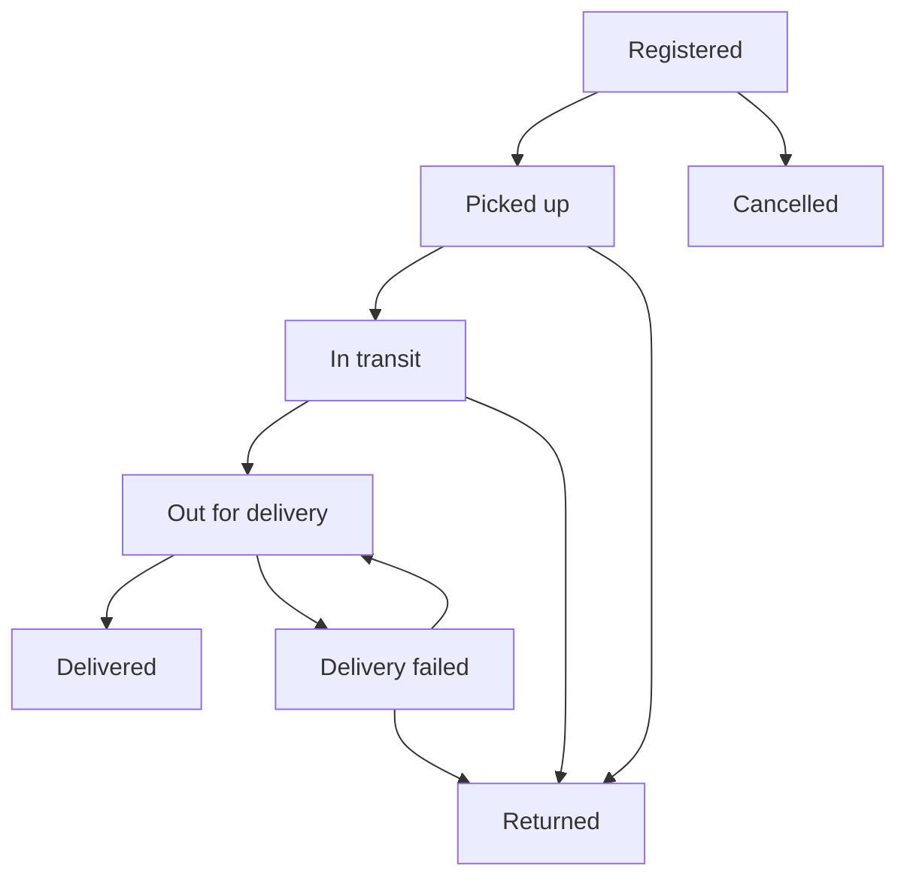

# Courier Parcel Tracking — Java Swing + JDBC + MySQL

The standalone desktop application is in **[jdbc-desktop/](jdbc-desktop/README.md)**. It uses Java 17, Swing, prepared JDBC statements, and MySQL — no Spring Boot or React required.

Includes administrator/agent login, parcel registration, public tracking, assignments, enforced status history, in-app notifications, search/filtering, pagination, and dashboard totals.

See **[setup and run instructions](jdbc-desktop/README.md)**.

---

## Original web application (preserved)

# Courier Tracker

A full-stack **Courier Parcel Tracking and Delivery Management** application built with **Java 17, Spring Boot, React, and MySQL**. Includes a persistent H2 option for an easy local demo.

## What works

- **Parcel registration:** sender/recipient details, weight, service type, expected delivery, server-generated UUID tracking IDs.
- **Public tracking:** searchable tracking ID and chronological journey; hides names, street addresses, phone numbers, emails, internal notes, and agent identity.
- **Delivery assignments:** admins assign or reassign an active agent; agents see only their own parcels.
- **Status history:** enforced transitions, immutable events, locations, notes, actor, and UTC timestamps.
- **Notifications:** persisted in-app assignment and delivery alerts; optional SMTP email with recorded delivery state and up to five attempts.
- **Dashboard:** total/active/delivered/failed counts, unassigned/overdue shipments, delivery percentage, recent parcels.
- **Operations:** paginated search, status filters, agent creation, notification read state, responsive layouts, keyboard-accessible dialogs.
- **Security:** BCrypt passwords, session cookies, CSRF protection, server-side authorization, pessimistic parcel locking and optimistic versions.
- **Database:** Flyway migrations, relational foreign keys, unique tracking IDs and emails, search-related indexes.

## Quick local demo

Install **JDK 17+, Maven 3.6.3+, and Node.js 22+**.

Terminal 1:

```bash
cd backend
DEMO_ENABLED=true mvn spring-boot:run
```

Terminal 2:

```bash
cd frontend
npm ci
npm run dev
```

Open **http://localhost:5173**. The API runs at **http://localhost:8080**. The Vite development proxy forwards `/api` to the API, including cookies.

| Role                                  | Email               | Password       |
| ------------------------------------- | ------------------- | -------------- |
| Administrator                         | admin@courier.local | DemoAdmin!2026 |
| Delivery agent                        | agent@courier.local | DemoAgent!2026 |
| Second agent (no initial assignments) | priya@courier.local | DemoAgent!2026 |

Public tracking examples: **CT-DEMO-1001** through **CT-DEMO-1006**. The six demo parcels cover registered, picked up, in transit, out for delivery, delivered, and failed delivery. Seeding happens only when `DEMO_ENABLED=true` and the parcel table is empty. Local data persists under `backend/data/`; stop the API and remove that directory to reset the local demo.

**Demo credentials are intentionally documented for local demonstrations. Keep `DEMO_ENABLED=false` for a real deployment.**

## Docker + MySQL

```bash
cp .env.example .env
# Edit .env: set unique database passwords and ADMIN_PASSWORD (12+ characters).
docker compose up --build
```

Open **http://localhost:8088**. The frontend is served by Nginx, which proxies `/api` to Spring Boot. MySQL persists in a named volume. This Docker configuration starts with an empty database and creates the admin specified in `.env`; it does not seed demo accounts unless you explicitly set `DEMO_ENABLED=true`.

To use MySQL without Docker, create a database named `courier`, then configure:

```bash
export DB_URL='jdbc:mysql://localhost:3306/courier?connectionTimeZone=UTC'
export DB_USERNAME='courier'
export DB_PASSWORD='your-database-password'
export ADMIN_EMAIL='admin@yourdomain.com'
export ADMIN_PASSWORD='your-unique-password-at-least-12-characters'
export DEMO_ENABLED=false
cd backend
mvn spring-boot:run
```

Admin credentials are used **only to bootstrap an empty user table**. Changing the environment does not reset an existing account's password. A production password reset flow is outside this project's scope.

## Delivery workflow



Assign an agent before progressing a delivery. Only admins may cancel registered parcels. Completed/cancelled/returned parcels cannot be reassigned or progressed. Failed deliveries can be retried or returned. Every assignment/status change appends an event in the same database transaction.

## Email notifications

In-app notifications work without external services. Set these environment variables for real recipient email:

```dotenv
EMAIL_ENABLED=true
SMTP_HOST=smtp.yourprovider.com
SMTP_PORT=587
SMTP_USERNAME=your-user
SMTP_PASSWORD=your-secret
SMTP_AUTH=true
SMTP_TLS=true
MAIL_FROM=deliveries@yourdomain.com
```

Registration and delivery updates queue emails to the recipient; assignments create agent in-app notifications. The dispatcher processes up to 20 messages every minute, with at most five attempts. Email states are **NOT_CONFIGURED**, **PENDING**, **SENT**, **FAILED**, or **IN_APP_ONLY**. Disabled-email messages are not automatically requeued when you enable email later. Email delivery is best effort and may duplicate after a process/database failure; the current dispatcher is intended for one API instance. SMTP provider integration is not required for the local demo.

## Tests

```bash
cd backend
mvn test
cd ../frontend
npm ci
npm run build
npx playwright install --with-deps chromium
npm run test:e2e
```

The end-to-end suite starts an isolated H2 API on port 8081 and Vite on port 5174 automatically. Ensure Java and Maven are on PATH. Tests cover sign-in, parcel registration, assignment, valid status updates, public tracking, search/filtering, agent isolation, notifications, and desktop/mobile layouts. Backend integration tests cover CSRF, authentication, authorization, state transitions, privacy, validation, pagination, and notification behavior. Email tests use a mocked sender; no real email is sent.

GitHub Actions runs the API tests, frontend build, and browser workflow tests on pushes and pull requests.

## Project structure

```text
backend/     Spring Boot API, entities, migration, workflow, security, tests
frontend/    React + Vite UI and Playwright workflow tests
 docs/       API reference and relational model
compose.yaml MySQL, API, and Nginx frontend
```

See [API reference](docs/API.md) and [database design](docs/DATABASE.md).

## Deployment notes

Use HTTPS at your reverse proxy and set `SECURE_COOKIES=true` in production. Keep frontend and API on the same origin, or configure the exact `FRONTEND_ORIGIN`; never use a wildcard with authenticated requests. Store credentials in environment/secrets, not git. Public tracking IDs are bearer references, so share them only with intended recipients. Add reverse-proxy rate limiting before exposing tracking and login to the internet. This project does not include SMS, GPS/live driver maps, payments, file attachments, password reset, or multi-instance mail coordination.

## JFLAP + JDBC + MySQL rebuild

See [the Java console rebuild](jdbc-jflap/README.md) for a standalone application whose delivery transitions are driven by an actual JFLAP `.jff` automaton and persisted with plain JDBC in a separate MySQL database.
