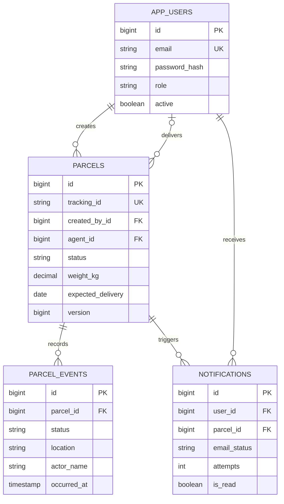

# Database design

Flyway migration: `backend/src/main/resources/db/migration/V1__initial_schema.sql`.

Assignments/status transitions lock the parcel row and commit parcel changes, history, and notifications together. An optimistic version guards against stale entity writes. Events are append-only through the API; there are no edit/delete endpoints for events. The role/status fields use Java enums persisted as strings. The same migration supports MySQL 8.4 and H2 in MySQL compatibility mode.

Foreign keys preserve parent relationships. Unique indexes protect tracking IDs and user emails. Additional indexes support status/agent filtering, ordered parcel events, and each user's notification feed. Internal timestamps are stored and interpreted as UTC. Tracking IDs use random UUIDs (demo IDs are deliberately recognizable).
